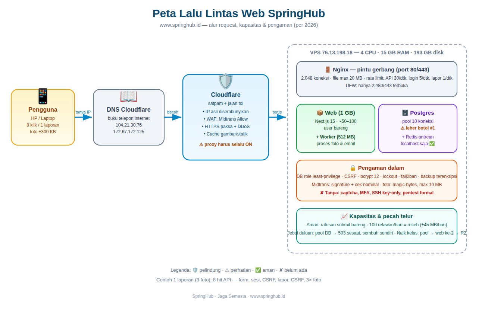

# Laporan Komprehensif SpringHub — Sistem, Kapasitas, Keamanan & Billing

**Proyek:** SpringHub — Jaga Semesta (www.springhub.id)
**Penyusun:** Ayatullah Reza — Full-stack Developer
**Tanggal:** Oktober 2026

---

## 1. Ringkasan Eksekutif

SpringHub berjalan di satu VPS (76.13.198.18) di belakang Cloudflare, melayani publik lewat HTTPS. Satu laporan warga (3 foto) hanya butuh ±8 hit API ringan. Sistem aman untuk launching dan ratusan submit bersamaan; leher botol pertama adalah pool database (10 koneksi).

## 2. Peta Lalu Lintas

Alur setiap klik: HP → DNS Cloudflare (104.21.30.76 / 172.67.172.125, IP asli disembunyikan) → Cloudflare (WAF, HTTPS paksa, anti-DDoS) → Nginx VPS (port 80/443) → aplikasi Next.js → Postgres + Redis (hanya localhost).

## 3. Kapasitas & Batas

| Lapisan | Batas | Artinya |
|---|---|---|
| Nginx | 2.048 koneksi/worker, file max 20 MB | Ribuan pengunjung bareng lolos |
| Rate limit | API 30/dtk, login 5/dtk, donasi 3/dtk, laporan 1/dtk per IP | Anti brute-force & spam |
| Pool database | 10 koneksi | Leher botol pertama |
| RAM aplikasi 1 GB | ±50–100 user aktif bareng | Cukup untuk launching |
| Foto | Max 10 MB, auto-kompres ±300 KB | 100 relawan/hari ≈ 45 MB/hari |

Contoh 1 laporan (3 foto) = 8 hit: definisi form, sesi, CSRF, kirim laporan, CSRF, 3× foto.

## 6. Anti Tagihan Ganda Donasi

Refresh/klik-ganda/timeout tidak menagih 2x: donasi pending yang sama (donor + nominal + proyek, umur < 15 menit) dipakai ulang `order_id`-nya; Midtrans menolak order ganda; webhook idempoten + CAS atomik; nominal webhook dicocokkan DB. Expiry transaksi tetap 24 jam (aman untuk VA bank).

## 4. Status Keamanan (audit 50 item)

**Sudah diterapkan:** RCE Next.js ditutup (15.5.26), DB least-privilege, `.env` 600, `x-powered-by` mati, backup terenkripsi + restore test lolos, CSRF semua mutasi, bcrypt 12 + lockout, reset token sekali pakai, upload magic-bytes + nama acak, HSTS/frame/nosniff/CSP/referrer aktif, rate limit + fail2ban + Sentry, Midtrans signature + cek nominal + IP Allow.

**Sengaja belum / butuh aksi pemilik:** MFA admin (ditolak), captcha (butuh kunci Turnstile), SSH key-only (butuh public key — tanpa ini jangan dimatikan), repo private (cek manual), pentest formal, prisma major, backup offsite (butuh tujuan), rotasi kredensial berkala.

## 5. Billing September 2026

| # | Uraian | Jumlah |
|---|---|---|
| 1 | Gaji | Rp3.500.000 |
| 2 | Ikan | Rp100.000 |
| 3 | Bensin | Rp50.000 |
| | **Total** | **Rp3.650.000** |

Bank BRI — 359001035332531 — a.n. Ayatullah Reza Chalid.

---

> Terima kasih atas kerjasamanya. SpringHub — Jaga Semesta — www.springhub.id
